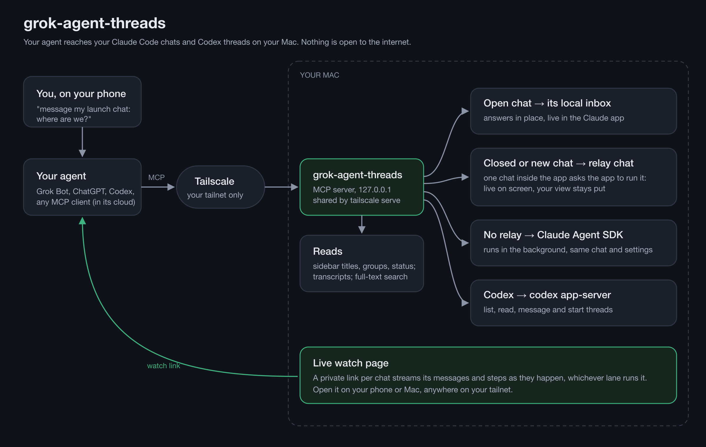

# grok-agent-threads

From your phone, ask Grok Bot (or ChatGPT, Codex, or any other agent that speaks MCP) about your Claude Code chats and Codex threads on your Mac, and have it message them:

> "list my pinned Claude chats"
> "what does my launch chat need from me?"
> "message my launch chat: where are we?"
> "start a Codex thread in my vault called Weekly review and ask it to draft the outline"



The agent gets the same reach into your chats that a Claude chat has from inside the Claude app. It sees the same titles, sidebar groups and status lines, it can read and search every conversation, and it can message any chat, open or closed, and get the answer back. It can also start new chats in the folder you name, and do all of the same with Codex threads.

Nothing on your Mac is exposed to the internet. The server listens on `127.0.0.1` only, and your tailnet reaches it through `tailscale serve`. A cloud agent like Grok Bot joins your tailnet through Tailscale's official OAuth app sign-in.

## Tools

| Tool | What it does |
|---|---|
| `list_chats` | Your Claude Code chats as the Claude app sidebar shows them, newest first. Each row has the title, whether the chat is open (busy or idle) or closed, last activity, group, pinned, and the chat's own one-line status or what it needs from you. Filter by title words, group or pinned |
| `list_groups` | Your sidebar groups, with how many chats each holds |
| `chat_status` | One chat in full: state, status, what it needs from you, folder, model, turns, link |
| `read_chat` | A chat's last messages, each labeled by who wrote it: you, the relaying agent, another session, or the chat |
| `search_chats` | Searches every conversation's full history |
| `message_chat` | Messages any chat and returns its answer. An open chat answers in place. A closed chat wakes up with its own folder, model, permission mode and settings |
| `start_chat` | Starts a new chat in a folder, names it, adds it to the Claude app sidebar, and returns its first answer and link. New chats start in auto mode |
| `connector_status` | Says whether closed and new chats run live in the Claude app right now or in the background, and what brings live mode back |
| `codex_list_threads` | Your Codex threads, newest first. Takes an optional search |
| `codex_read_thread` | A Codex thread's last turns |
| `codex_message_thread` | Messages a Codex thread and returns the answer. A thread the ChatGPT app has open gets the message through its queue |
| `codex_start_thread` | Starts a named Codex thread in a folder |

There is no tool to delete, archive or stop a chat or thread, on purpose.

## Seeing the work

- **In the Claude app.** A chat that is open in the app answers in place, live. A closed or new chat runs live too when the relay chat is open: one small chat inside the app that asks the app to wake the target ([docs/relay.md](docs/relay.md)). Without the relay, closed and new chats work in the background and show the result when you open them.
- **In a browser, anywhere on your tailnet.** Every result that says "still working" carries a private watch link, and `chat_status` gives one for any chat. The page streams the chat's messages and steps as they happen, on your phone or your Mac, whichever way the turn runs.

## Install

**By prompt (recommended).** Paste [docs/install-prompt.md](docs/install-prompt.md) into Claude Code on your Mac. Claude checks what you have, installs the server as a login item shared on your tailnet only, tests it, starts the relay chat, and hands you the setup prompt for your agent with your address filled in.

**By hand.** You need macOS, Claude Code (the Claude desktop app is optional), [uv](https://docs.astral.sh/uv/), [ripgrep](https://github.com/BurntSushi/ripgrep), and the Tailscale app signed in. Codex is optional; its tools turn on when the ChatGPT app or the `codex` CLI is installed.

```bash
git clone https://github.com/ArtemXTech/grok-agent-threads ~/grok-agent-threads
cd ~/grok-agent-threads
scripts/install.sh "Your Name" "Grok Bot"   # your name, and the agent that will call it
uv run scripts/check.py                     # tools, status and your newest chats
```

`install.sh` keeps the server running as a login item on `127.0.0.1:8857`, shares it on your tailnet with `tailscale serve` (never Funnel), creates an access key, and prints the address with it, for example `https://your-mac.your-tailnet.ts.net:8857/mcp?key=...`. `scripts/install.sh --uninstall` removes both.

**Connect your agent.**
- **Grok Bot:** paste [docs/grok-setup-prompt.md](docs/grok-setup-prompt.md) into Grok Bot with your address filled in. Grok connects its Tailscale plugin (you click once to sign in), adds the server, and runs a full test.
- **Any other MCP client:** add the address (with its `?key=`) as a streamable HTTP MCP server. On the same Mac you can use stdio instead: `uv run --directory ~/grok-agent-threads grok-agent-threads --stdio`.
- **Live work in the Claude app:** start the relay chat once ([docs/relay.md](docs/relay.md)). The install prompt does it for you.

## Settings

All settings are environment variables. `scripts/run.sh` passes them through, and `scripts/install.sh` writes them into the login item.

| Variable | Default | Meaning |
|---|---|---|
| `GROK_AGENT_THREADS_OWNER` | `the owner` | Your name, used in the note on every relayed message |
| `GROK_AGENT_THREADS_CALLER` | `Grok Bot` | The agent that calls the server |
| `GROK_AGENT_THREADS_KEY` | set by `install.sh` | Access key every MCP request must carry (`?key=` or `Authorization: Bearer`). Empty: tailnet only |
| `GROK_AGENT_THREADS_PORT` | `8857` | Port on `127.0.0.1` |
| `GROK_AGENT_THREADS_HOSTS` | set by `run.sh` | Extra Host headers to accept (your tailnet name). Any other Host is refused |
| `GROK_AGENT_THREADS_ANSWER_WAIT` | `45` | Seconds a call waits for an answer before it reports "still working" (the work goes on) |
| `GROK_AGENT_THREADS_NEW_CHAT_MODE` | `auto` | Permission mode for `start_chat` |
| `GROK_AGENT_THREADS_LOG_DIR` | `~/.grok-agent-threads/logs` | Where every call is logged (`calls.jsonl`) |

## Security

Read [docs/security.md](docs/security.md) before you connect a cloud agent. In short:
- **Who can reach it:** only devices on your tailnet that also have your access key (the installer makes one). The Grok Bot device joins with your identity, so it can also reach your other devices. To prevent that, give it a tag and allow that tag only this port; the doc has a ready policy.
- **What the agent can do:** whatever your chats can do. A closed chat wakes up in its own permission mode, which can mean edits and commands on your Mac without a prompt.
- **What a chat is told:** every relayed message opens with a note. It says who typed the words and that they are never your approval for anything outward (sending, posting, paying).
- **Your words only:** tell your agent to pass along only words you typed. The setup prompt does this.

## How it works

See [docs/how-it-works.md](docs/how-it-works.md), including which parts rely on documented interfaces and which rely on app internals that an update could move.

## Tests

```bash
uv run --group dev pytest
```

The tests run against synthetic data in a temporary home folder and never touch your real chats.

## License

MIT
